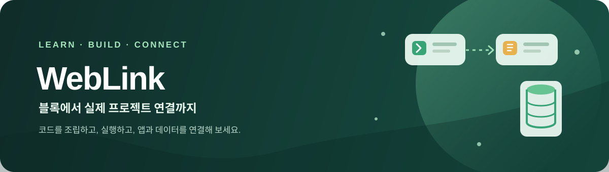
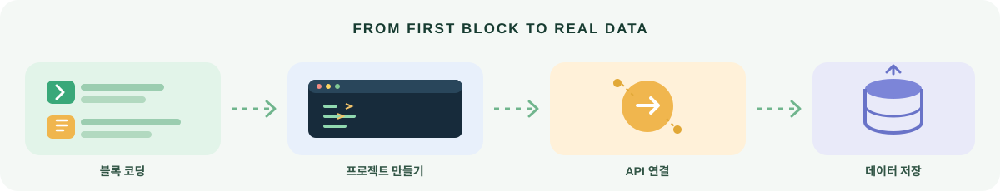

<div align="center">



<h1>WebLink</h1>

**직접 만들고 실행하며, 화면에서 API와 데이터베이스 연결까지**

예측하고 코드를 작성한 뒤 실제 실행 결과를 관찰하며 React·FastAPI·SQLite의 연결을 익히는 교육용 개발 플랫폼입니다. 학습자는 원하는 AI 웹사이트나 CLI를 직접 사용할 수 있고, 새 통합 과정은 AI API 키 없이도 진행할 수 있습니다.

[시작하기](#-빠른-시작) · [무엇을 할 수 있나요?](#-배우고-만들기) · [프로젝트 현황](docs/PROJECT_STATUS_KO.md)

</div>

<p align="center">
  
  
  
  
  
</p>

## ✨ 배우고 만들기

<p align="center">
  
</p>

| 🧭 미션으로 배우기 | 🛠️ 프로젝트로 이어가기 | 🔗 연결 결과 관찰하기 |
| --- | --- | --- |
| M01~M12에서 목표·요구사항·폼·React·API·SQLite·오류 분석·응용을 진행합니다. 기존 블록 수업과 기록도 보존합니다. | 학습 코드와 실행 구성을 개인 프로젝트로 가져오고 파일·팀원·버전을 관리합니다. | 실제 HTTP·SQLite 행·React 렌더러 결과를 보고, 기초 설명을 본 뒤 원래 코드 위치로 돌아옵니다. |

- **실습부터 프로젝트까지** — 학습 내용을 실제 Python 프로젝트에서 실행해 봅니다.
- **바로 실행할 수 있는 예제** — 여러 파일로 구성된 독서 기록 앱에서 SQLite 데이터 저장과 수정 흐름을 살펴봅니다.
- **폴더로 코드 정리하기** — 프로젝트 파일을 폴더로 나누고, 파일을 폴더에 넣거나 루트로 꺼내며 PC의 텍스트 파일과 폴더도 끌어와 구성할 수 있습니다. 폴더 이름 변경과 안의 파일을 포함한 삭제도 지원합니다.
- **함께 이어서 작업하기** — WebLink 계정 이메일로 팀원을 추가해 편집자 또는 보기 전용 권한을 부여하고, 저장된 변경 사항을 공유할 수 있습니다. 다른 팀원의 저장은 내 화면에 자동 반영되며, 저장되지 않은 내 코드가 있을 때는 덮어쓰지 않고 최신 초안 불러오기를 안내합니다. 프로젝트 파일은 ZIP 또는 내 컴퓨터 폴더로 옮겨 GitHub Desktop에서도 관리할 수 있습니다.
- **저장 버전 관리** — 저장 버전에 만든 사람과 날짜를 표시하고, 다른 팀원이 초안을 갱신한 뒤 오래된 화면에서 복원을 시도하면 최신 버전을 다시 확인합니다.
- **프로젝트 관리** — 소유자는 프로젝트 이름·설명과 팀원의 편집/보기 권한을 언제든 변경할 수 있습니다.
- **작업 나누기** — 할 일·진행 중·완료 보드에서 작업의 설명, 담당 팀원, 우선순위와 마감일을 관리할 수 있습니다. 내 작업과 담당자, 우선순위, 마감일로 찾아보고 완료율을 확인하세요. 체크리스트로 세부 단계를 나누고, 작업별 댓글과 변경 기록을 공유하며 최근 활동 알림으로 팀 진행 상황을 따라갈 수 있습니다.
- **안전한 연결 실습** — Google Sheets 읽기 권한과 프로젝트별 데이터베이스를 사용해 데이터 연동 과정을 배웁니다.

> 새 통합 과정은 구현 범위를 순차 검증하는 `partial` 상태입니다. M01~M12 저장·실행·제출 경로는 연결했으며, 확인용 계정의 M01~M12 API 완주와 일부 충돌·복귀·실제 앱 저장은 확인했으며, 전체 브라우저 완주·다중 사용자·격리 검증은 남아 있습니다. React 결과는 실제 Test Renderer이며 브라우저 DOM/CORS 전체 검증은 아닙니다. [검증 기록](docs/VERIFY_REPORT.md)과 [남은 작업](docs/NEXT_STEPS.md)을 확인하세요.

## 📚 새 통합 학습 흐름

- **M01~M04:** 목표·요구사항을 정리하고 HTML 폼과 JavaScript 검증을 만듭니다.
- **M05~M07:** React 상태와 FastAPI의 실제 GET/POST를 연습합니다.
- **M08~M10:** SQLite 파일 저장, API 서버 재시작, React→API→DB 연결과 재고 목록 전이를 구현합니다.
- **M11~M12:** 실패 재현본/수정본을 비교하고 메모장·할 일 목록에 적용합니다.
- **학습 이후:** 개인 프로젝트 생성, 중복 생성 방지, 코드 위치 복귀, 전체 기록 다운로드를 제공합니다. 새 학습 코드는 이전 원본·현재 프로젝트와 비교하고 충돌 선택 후 반영합니다. 반영 전 서버 초안도 코드 버전으로 보관합니다.
- **실행 기록:** M06 이후 최근 저장된 실행을 선택해 새 실행 없이 결과를 다시 열고 내려받습니다.

프로젝트로 가져온 앱에는 한국어 README와 Docker Compose 실행 파일이 포함됩니다. WebLink는 5173, 가져온 앱의 별도 로컬 실행 구성은 화면 5174/API 8081을 사용합니다. 확인용 메모장 앱의 실제 빌드·기동·브라우저 저장/새로고침 유지를 확인했습니다. Google 연결과 기존 AI API 기능은 선택 기능이며 새 학습 과정의 필수 조건이 아닙니다.

## 🚀 빠른 시작

필요한 환경: **Docker Desktop**과 **Git**. 저장소를 받은 뒤 프로젝트 루트에서 실행합니다.

```bash
docker compose up --build -d
```

웹 앱: <http://localhost:5173>  ·  API 상태: <http://localhost:8000/health>

환경에 맞는 값이 필요하면 `.env.example`을 참고해 `.env`를 준비하세요. 실제 API 키, OAuth 비밀값, 암호화 키가 담긴 `.env`는 공유하거나 GitHub에 올리지 마세요.

## 🧭 프로젝트 안내

- [한국어 프로젝트 진행 상황과 기능 안내](docs/PROJECT_STATUS_KO.md)
- [학습 구조와 구현 범위](docs/LEARNING_ARCHITECTURE.md)
- [미션 구성](docs/CURRICULUM_MAP.md)
- [검증 기록과 제한사항](docs/VERIFY_REPORT.md)
- [다음 단계](docs/NEXT_STEPS.md)
- [환경 변수 예시](.env.example)

## 🔐 실행 및 연동 안내

학습용 Python 코드는 제한된 Docker 컨테이너에서 실행됩니다. Google 연결은 기능별 권한을 사용하며 OAuth 토큰은 서버에 암호화해 저장합니다. 공개 서비스로 배포하려면 HTTPS, 허용 출처, Docker 권한 등 운영 환경을 별도로 설정해야 합니다.

저장소에 라이선스 파일은 아직 없습니다. 재사용 및 배포 조건은 라이선스가 추가된 뒤 확정됩니다.
